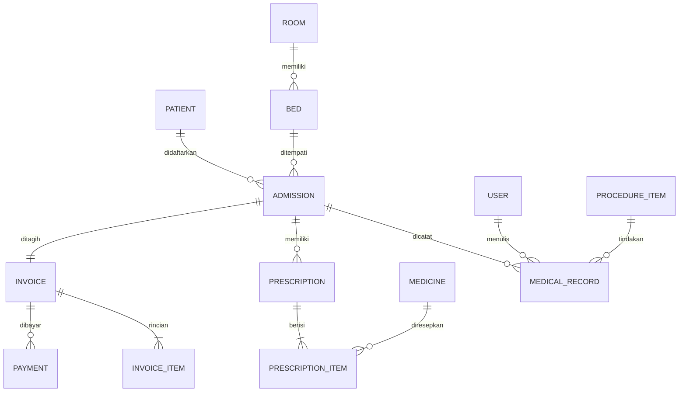

# PRD & Tech Stack: Sistem Administrasi Rawat Inap Rumah Sakit

| | |
|---|---|
| **Versi** | 1.0 (Draft) |
| **Tanggal** | 13 November 2026 |
| **Jenis dokumen** | Product Requirements Document + Rekomendasi Tech Stack |
| **Sumber** | Studi kasus + DFD Level 0 dan Level 1 |

---

## 1. Ringkasan

Rumah sakit yang menangani pasien rawat inap membutuhkan sistem administrasi yang andal karena jumlah pasien terus bertambah. Sistem lama tidak mengikuti perkembangan: komputer hanya dipakai sebagai pengganti mesin tik dan alat hitung, sehingga pelayanan lambat dan pasien sering mengeluh.

Produk ini adalah **web app administrasi rawat inap** yang mengotomasi alur pendaftaran, pengelolaan kamar, pelayanan medis, farmasi, pembayaran, dan pelaporan dalam satu sistem terpadu.

## 2. Latar Belakang & Masalah

| Masalah (dari kasus) | Dampak | Solusi di produk |
|---|---|---|
| Pencatatan manual/semi-manual | Data lambat dicari, rawan salah | Database terpusat, pencarian cepat |
| Sistem tidak mampu memenuhi banyak kebutuhan | Pelayanan kurang memuaskan | Modul terintegrasi dari daftar sampai bayar |
| Komputer hanya sebagai mesin tik dan kalkulator | Tidak ada otomasi | Perhitungan tagihan otomatis, alur kerja digital |
| Pasien bertambah banyak | Antrean dan kamar sulit dikelola | Status kamar real-time, pendaftaran terstruktur |
| Keluhan pasien | Kepuasan rendah | Informasi tagihan, kamar, dan bukti daftar jelas |

## 3. Tujuan & Metrik Keberhasilan

**Tujuan**
1. Memangkas waktu pendaftaran pasien rawat inap.
2. Menghilangkan pencatatan ganda dan kesalahan hitung tagihan.
3. Memberi pimpinan laporan yang akurat tanpa rekap manual.
4. Menyediakan rekam medis rawat inap yang terpusat dan mudah dilacak.

**Metrik (target awal, bisa disesuaikan)**

| Metrik | Target |
|---|---|
| Waktu pendaftaran pasien rawat inap | ≤ 3 menit |
| Akurasi tagihan (tanpa koreksi manual) | ≥ 99% |
| Waktu membuat laporan bulanan | ≤ 1 menit (otomatis) |
| Ketersediaan sistem | ≥ 99,5% |

## 4. Ruang Lingkup

**Dalam lingkup (MVP)**
- Pendaftaran pasien rawat inap
- Pengelolaan kamar dan tempat tidur
- Pelayanan medis dan rekam medis rawat inap
- Pengelolaan obat dan resep
- Pembayaran dan penagihan
- Pelaporan untuk pimpinan
- Autentikasi dan hak akses berbasis peran

**Di luar lingkup (rilis ini)**
- Rawat jalan dan IGD
- Integrasi BPJS/asuransi (V2)
- Integrasi lab dan radiologi
- Portal pasien dan aplikasi mobile
- Pembayaran online / payment gateway

## 5. Pengguna & Peran

DFD punya 6 entitas eksternal. Di aplikasi, tidak semuanya login.

| Entitas DFD | Peran di aplikasi | Login? | Catatan |
|---|---|---|---|
| Pasien | Data subjek | Tidak (MVP) | Datanya diinput petugas. Portal pasien masuk V2 |
| (Tambahan) | **Petugas Pendaftaran** | Ya | Menginput data pendaftaran. Bisa digabung dengan Kasir kalau RS kecil |
| Dokter | Dokter | Ya | Diagnosa, tindakan, resep |
| Perawat | Perawat | Ya | Data perawatan, instruksi dokter |
| Apoteker | Apoteker | Ya | Resep dan stok obat |
| Kasir | Kasir | Ya | Tagihan dan pembayaran |
| Pimpinan RS | Pimpinan | Ya | Laporan (read-only) |
| (Tambahan) | **Admin Sistem** | Ya | Kelola user, master data |

## 6. Pemetaan DFD ke Modul

| Proses DFD Level 1 | Modul aplikasi | Data store |
|---|---|---|
| 1. Pendaftaran Pasien | Modul Pendaftaran | D1 Data Pasien |
| 2. Pengelolaan Kamar | Modul Kamar | D2 Data Kamar |
| 3. Pembayaran & Penagihan | Modul Kasir | D3 Data Transaksi |
| 4. Pengelolaan Obat | Modul Farmasi | D4 Data Obat |
| 5. Pelayanan Medis & Rekam Medis | Modul Klinis | D5 Rekam Medis |
| 6. Pembuatan Laporan | Modul Laporan | Membaca D1–D5 |

## 7. Kebutuhan Fungsional

Prioritas: **P0** = wajib MVP, **P1** = penting, **P2** = nanti.

### 7.1 Autentikasi & Hak Akses
| ID | Kebutuhan | Prioritas |
|---|---|---|
| FR-AUTH-01 | Login dengan username/email dan password | P0 |
| FR-AUTH-02 | Hak akses per peran (RBAC), lihat matriks di bagian 8 | P0 |
| FR-AUTH-03 | Admin dapat membuat, menonaktifkan, dan mengatur ulang password user | P0 |
| FR-AUTH-04 | Audit log: siapa mengubah apa dan kapan | P1 |

### 7.2 Pendaftaran Pasien (Proses 1)
| ID | Kebutuhan | Prioritas |
|---|---|---|
| FR-REG-01 | Input pasien baru (identitas, kontak, penanggung jawab) dan otomatis membuat **No. Rekam Medis** unik | P0 |
| FR-REG-02 | Cari pasien lama (nama, NIK, No. RM) agar tidak ada data ganda | P0 |
| FR-REG-03 | Buat pendaftaran rawat inap (tanggal masuk, dokter penanggung jawab, diagnosa awal) | P0 |
| FR-REG-04 | Kirim permintaan kamar ke modul Kamar (alur Proses 1 → 2) | P0 |
| FR-REG-05 | Cetak **bukti pendaftaran** (PDF) | P0 |
| FR-REG-06 | Edit data pasien dengan riwayat perubahan | P1 |

### 7.3 Pengelolaan Kamar (Proses 2)
| ID | Kebutuhan | Prioritas |
|---|---|---|
| FR-ROOM-01 | Master data kamar: kelas (VIP, I, II, III), tarif per hari, kapasitas bed | P0 |
| FR-ROOM-02 | Lihat ketersediaan kamar/bed secara real-time | P0 |
| FR-ROOM-03 | Alokasikan pasien ke bed, dengan validasi bed tidak boleh ganda | P0 |
| FR-ROOM-04 | Pindah kamar dan checkout (pasien pulang), bed otomatis kembali tersedia | P0 |
| FR-ROOM-05 | Hitung lama inap dan biaya kamar otomatis, dikirim ke Kasir | P0 |

### 7.4 Pelayanan Medis & Rekam Medis (Proses 5)
| ID | Kebutuhan | Prioritas |
|---|---|---|
| FR-MED-01 | Dokter menginput diagnosa, tindakan, dan catatan visite | P0 |
| FR-MED-02 | Dokter membuat resep, diteruskan ke Farmasi | P0 |
| FR-MED-03 | Perawat mencatat tanda vital dan perkembangan harian | P0 |
| FR-MED-04 | Perawat melihat instruksi dokter untuk pasien yang dirawat | P0 |
| FR-MED-05 | Lihat riwayat rekam medis per pasien (timeline) | P0 |
| FR-MED-06 | Rekam medis tidak bisa dihapus, hanya dikoreksi dengan jejak audit | P1 |
| FR-MED-07 | Master tindakan beserta tarifnya, biaya tindakan masuk ke tagihan | P0 |

### 7.4 Pengelolaan Obat (Proses 4)
| ID | Kebutuhan | Prioritas |
|---|---|---|
| FR-PHA-01 | Master data obat (nama, satuan, harga, stok, stok minimum) | P0 |
| FR-PHA-02 | Apoteker melihat resep masuk dan memprosesnya (status: menunggu, disiapkan, diserahkan) | P0 |
| FR-PHA-03 | Stok berkurang otomatis saat resep diserahkan | P0 |
| FR-PHA-04 | Peringatan stok menipis | P1 |
| FR-PHA-05 | Biaya obat otomatis masuk ke tagihan pasien (alur Proses 4 → 3) | P0 |
| FR-PHA-06 | Penambahan stok (barang masuk) | P1 |

### 7.5 Pembayaran & Penagihan (Proses 3)
| ID | Kebutuhan | Prioritas |
|---|---|---|
| FR-BIL-01 | Tagihan otomatis menggabungkan biaya kamar, tindakan, dan obat | P0 |
| FR-BIL-02 | Kasir melihat rincian tagihan per pasien | P0 |
| FR-BIL-03 | Catat pembayaran (tunai, transfer, debit), dukung bayar sebagian (cicilan) | P0 |
| FR-BIL-04 | Cetak **kuitansi/bukti bayar** dan rincian tagihan (PDF) | P0 |
| FR-BIL-05 | Status tagihan: belum bayar, sebagian, lunas | P0 |
| FR-BIL-06 | Pasien baru boleh checkout setelah tagihan lunas (bisa di-override Admin dengan alasan) | P1 |
| FR-BIL-07 | Diskon/penyesuaian dengan persetujuan dan alasan tercatat | P2 |

### 7.6 Pelaporan (Proses 6)
| ID | Kebutuhan | Prioritas |
|---|---|---|
| FR-REP-01 | Dashboard ringkas: pasien dirawat, okupansi kamar (BOR), pendapatan hari/bulan ini | P0 |
| FR-REP-02 | Laporan pasien (masuk, keluar, sedang dirawat) per periode | P0 |
| FR-REP-03 | Laporan keuangan per periode | P0 |
| FR-REP-04 | Laporan okupansi kamar | P0 |
| FR-REP-05 | Laporan pemakaian dan stok obat | P0 |
| FR-REP-06 | Ekspor laporan ke PDF dan Excel | P1 |

## 8. Matriks Hak Akses (RBAC)

C = Create, R = Read, U = Update, D = Delete, ✗ = tidak ada akses

| Resource | Admin | Pendaftaran | Dokter | Perawat | Apoteker | Kasir | Pimpinan |
|---|---|---|---|---|---|---|---|
| User & master data | CRUD | ✗ | ✗ | ✗ | ✗ | ✗ | ✗ |
| Pasien | CRU | CRU | R | R | R | R | R |
| Pendaftaran rawat inap | R | CRU | R | R | ✗ | R | R |
| Kamar & bed | CRUD | R | R | RU | ✗ | R | R |
| Rekam medis | R | ✗ | CRU | CR | R | ✗ | ✗ |
| Resep | R | ✗ | CR | R | RU | ✗ | ✗ |
| Obat & stok | CRUD | ✗ | R | R | CRU | ✗ | R |
| Tagihan & pembayaran | R | R | ✗ | ✗ | R | CRU | R |
| Laporan | R | ✗ | ✗ | ✗ | ✗ | R (keuangan) | R |

> Catatan privasi: rekam medis adalah data pribadi sensitif. Akses dibatasi sesuai peran dan setiap akses tercatat di audit log.

## 9. Alur Pengguna Utama

```
Pendaftaran → Alokasi Kamar → Visite & Tindakan (Dokter/Perawat)
     → Resep → Farmasi menyiapkan obat → Tagihan otomatis
     → Pembayaran (Kasir) → Checkout & bed dibebaskan → Laporan
```

**Skenario utama: pasien masuk sampai pulang**
1. Petugas mencari pasien. Kalau belum ada, buat pasien baru dan No. RM.
2. Petugas membuat pendaftaran rawat inap dan memilih kamar yang tersedia.
3. Sistem mengalokasikan bed dan mencetak bukti pendaftaran.
4. Dokter melakukan visite, mengisi diagnosa dan tindakan, lalu membuat resep.
5. Perawat mencatat tanda vital harian dan menjalankan instruksi dokter.
6. Apoteker menyiapkan dan menyerahkan obat, stok berkurang.
7. Sistem menghitung tagihan (kamar × hari + tindakan + obat).
8. Kasir menerima pembayaran dan mencetak kuitansi.
9. Pasien checkout dan bed kembali tersedia.
10. Pimpinan melihat angka terbaru di dashboard dan laporan.

## 10. Model Data (turunan D1–D5)



| Tabel | Data store | Kolom kunci (ringkas) |
|---|---|---|
| `users` | (pendukung) | id, name, email, password_hash, role, is_active |
| `patients` | D1 | id, medical_record_no, nik, name, birth_date, gender, address, phone, guardian_name |
| `rooms` | D2 | id, name, class, daily_rate |
| `beds` | D2 | id, room_id, code, status |
| `admissions` | D1/D2 | id, patient_id, bed_id, doctor_id, admitted_at, discharged_at, initial_diagnosis, status |
| `medical_records` | D5 | id, admission_id, author_id, type (visite/vital/tindakan), content, vitals (JSON), created_at |
| `procedure_items` | D5 | id, name, price |
| `medicines` | D4 | id, name, unit, price, stock, min_stock |
| `prescriptions` | D4 | id, admission_id, doctor_id, status |
| `prescription_items` | D4 | id, prescription_id, medicine_id, qty, instruction |
| `invoices` | D3 | id, admission_id, total, paid_amount, status |
| `invoice_items` | D3 | id, invoice_id, type (kamar/tindakan/obat), description, qty, unit_price, subtotal |
| `payments` | D3 | id, invoice_id, amount, method, paid_at, cashier_id |
| `audit_logs` | (pendukung) | id, user_id, action, entity, entity_id, diff, created_at |

**Aturan bisnis penting**
- Satu bed hanya boleh dipakai satu admisi aktif pada satu waktu.
- Biaya kamar = jumlah hari inap × tarif kamar (hari masuk dihitung, dan aturan pembulatan disepakati dengan RS).
- Stok obat tidak boleh negatif.
- Tagihan `lunas` bila `paid_amount ≥ total`.
- Rekam medis bersifat append-only.

## 11. Kebutuhan Non-Fungsional

| Kategori | Kebutuhan |
|---|---|
| **Keamanan** | Password di-hash (argon2/bcrypt), HTTPS wajib, proteksi CSRF/XSS/SQL injection, session timeout, rate limit login |
| **Privasi** | Enkripsi koneksi dan backup, akses data sesuai peran, audit log akses rekam medis |
| **Kinerja** | Halaman utama ≤ 2 detik, pencarian pasien ≤ 1 detik pada 100 ribu data |
| **Ketersediaan** | Backup database harian, prosedur restore teruji |
| **Skalabilitas** | Mendukung ±100 user bersamaan pada MVP |
| **Usability** | Responsif (desktop, tablet), antarmuka bahasa Indonesia, aksesibel (kontras, navigasi keyboard) |
| **Maintainability** | Kode TypeScript, test otomatis untuk aturan bisnis, migrasi database terversi |
| **Kepatuhan** | Perhatikan UU Pelindungan Data Pribadi dan regulasi rekam medis (Permenkes) saat dipakai di RS sungguhan |

## 12. Rekomendasi Tech Stack

### 12.1 Stack utama (direkomendasikan)

| Lapisan | Pilihan | Alasan |
|---|---|---|
| Framework | **Next.js (App Router) + TypeScript** | Satu codebase untuk frontend dan backend, ekosistem besar, mudah di-deploy |
| UI | **Tailwind CSS + shadcn/ui** | Cepat membuat tabel, form, dan dialog yang rapi |
| Form & validasi | **React Hook Form + Zod** | Validasi sama di client dan server |
| Data fetching | **TanStack Query** (client) + Server Actions/Route Handlers | Cache, loading state, dan sinkronisasi data |
| Tabel & chart | **TanStack Table + Recharts** | Tabel pasien/tagihan dan grafik dashboard |
| Database | **PostgreSQL** | Relasional dan transaksional, cocok untuk data keuangan dan medis |
| ORM | **Prisma** (atau Drizzle) | Skema terversi, migrasi mudah, type-safe |
| Autentikasi | **Auth.js** (atau Better Auth) + RBAC middleware | Sesi aman, peran per user |
| PDF | **@react-pdf/renderer** atau Puppeteer | Bukti daftar, kuitansi, laporan |
| Ekspor Excel | **exceljs** | Ekspor laporan |
| Testing | **Vitest** (unit), **Playwright** (E2E) | Menguji aturan bisnis dan alur utama |
| Kualitas kode | ESLint, Prettier, Husky | Konsistensi tim |

### 12.2 Infrastruktur

| Kebutuhan | Opsi |
|---|---|
| Hosting aplikasi | Vercel (cepat dan mudah) **atau** VPS + Docker (kontrol data penuh, lebih cocok untuk data medis) |
| Database | Neon / Supabase / PostgreSQL di VPS |
| CI/CD | GitHub Actions |
| Monitoring | Sentry (error), log terpusat |
| Backup | `pg_dump` terjadwal ke penyimpanan terpisah |

### 12.3 Alternatif (kalau tim lebih familiar)

| Opsi | Stack | Cocok jika |
|---|---|---|
| **A. Laravel** | Laravel + Livewire/Inertia + MySQL + Filament (admin panel) | Tim biasa PHP. Filament sangat mempercepat CRUD. Umum dipakai di kampus/industri Indonesia |
| **B. Pemisahan FE/BE** | React (Vite) + NestJS + PostgreSQL | Mau API terpisah untuk mobile di masa depan |

> **Saran:** untuk tugas kuliah dengan tenggat, **Laravel + Filament** biasanya paling cepat selesai. Untuk portofolio dan pembelajaran modern, pilih **Next.js + PostgreSQL + Prisma**.

## 13. Arsitektur

```
┌──────────────┐     HTTPS     ┌──────────────────────────┐     ┌────────────┐
│ Browser      │ ────────────► │ Next.js                  │ ──► │ PostgreSQL │
│ (7 peran)    │ ◄──────────── │  • UI (React/shadcn)     │ ◄── │            │
└──────────────┘               │  • Server Actions / API  │     └────────────┘
                               │  • Auth + RBAC middleware│
                               │  • Service layer (aturan │     ┌────────────┐
                               │    bisnis: billing, bed) │ ──► │ Storage    │
                               └──────────────────────────┘     │ (PDF/backup)│
                                                                └────────────┘
```

**Struktur folder (modular, sesuai proses DFD)**
```
src/
├─ app/
│  ├─ (auth)/login
│  ├─ dashboard/
│  ├─ registration/     # Proses 1
│  ├─ rooms/            # Proses 2
│  ├─ billing/          # Proses 3
│  ├─ pharmacy/         # Proses 4
│  ├─ clinical/         # Proses 5
│  └─ reports/          # Proses 6
├─ server/
│  ├─ services/         # aturan bisnis (hitung tagihan, alokasi bed)
│  ├─ repositories/     # akses database
│  └─ auth/             # RBAC
├─ components/
├─ lib/
└─ prisma/schema.prisma
```

**Contoh endpoint utama**

| Method | Endpoint | Fungsi |
|---|---|---|
| POST | `/api/patients` | Buat pasien baru |
| GET | `/api/patients?q=` | Cari pasien |
| POST | `/api/admissions` | Daftar rawat inap |
| POST | `/api/admissions/:id/discharge` | Checkout pasien |
| GET | `/api/rooms/availability` | Ketersediaan kamar |
| POST | `/api/admissions/:id/records` | Tambah rekam medis |
| POST | `/api/prescriptions` | Buat resep |
| PATCH | `/api/prescriptions/:id/dispense` | Serahkan obat |
| GET | `/api/invoices/:admissionId` | Rincian tagihan |
| POST | `/api/invoices/:id/payments` | Catat pembayaran |
| GET | `/api/reports/:type?from=&to=` | Laporan |

## 14. Roadmap

| Fase | Durasi (estimasi) | Isi |
|---|---|---|
| **0. Persiapan** | 1 minggu | Setup repo, database, auth, layout dasar, seed data |
| **1. Pendaftaran + Kamar** | 2 minggu | FR-REG, FR-ROOM |
| **2. Klinis + Farmasi** | 2–3 minggu | FR-MED, FR-PHA |
| **3. Kasir** | 2 minggu | FR-BIL |
| **4. Laporan + Dashboard** | 1–2 minggu | FR-REP |
| **5. Hardening** | 1–2 minggu | Audit log, testing, perbaikan UX, dokumentasi, deploy |
| **V2** | Setelah MVP | Portal pasien, BPJS/asuransi, notifikasi, lab/radiologi |

## 15. Kriteria Penerimaan MVP

- [ ] Petugas bisa mendaftarkan pasien baru dan membuat admisi dalam ≤ 3 menit.
- [ ] Bed yang sama tidak bisa dipakai dua pasien aktif.
- [ ] Dokter bisa mengisi diagnosa, tindakan, dan resep, dan data muncul di sisi Perawat/Apoteker.
- [ ] Stok obat berkurang otomatis dan tidak bisa negatif.
- [ ] Tagihan otomatis memuat kamar + tindakan + obat dengan total yang benar.
- [ ] Pembayaran sebagian dan lunas tercatat, dan kuitansi bisa dicetak.
- [ ] Setiap peran hanya bisa mengakses menu sesuai matriks RBAC.
- [ ] Pimpinan bisa melihat dashboard dan 4 jenis laporan (pasien, keuangan, kamar, obat).
- [ ] Seluruh perubahan penting tercatat di audit log.

## 16. Risiko & Mitigasi

| Risiko | Dampak | Mitigasi |
|---|---|---|
| Scope terlalu besar untuk waktu yang ada | Tidak selesai | Kerjakan sesuai prioritas P0 dulu, P1/P2 belakangan |
| Salah hitung tagihan | Kerugian finansial, komplain | Aturan bisnis di service layer + unit test |
| Kebocoran data medis | Pelanggaran privasi | RBAC ketat, audit log, HTTPS, enkripsi backup |
| Adopsi rendah oleh staf | Sistem tidak dipakai | UI sederhana, pelatihan, uji coba dengan pengguna nyata |
| Data ganda pasien | Rekam medis terpecah | Pencarian wajib sebelum buat pasien baru, validasi NIK |

## 17. Asumsi & Pertanyaan Terbuka

1. Pasien tidak login pada MVP, datanya diinput petugas.
2. Peran **Petugas Pendaftaran** dan **Admin Sistem** ditambahkan karena dibutuhkan secara operasional, walau tidak ada di DFD.
3. Aliran "Pasien membayar langsung" digambarkan lewat Kasir, sesuai DFD Level 1.
4. Aturan pembulatan hari inap dan kebijakan diskon belum ditentukan. **Perlu konfirmasi** ke pihak RS/dosen.
5. Apakah dosen mewajibkan bahasa/framework tertentu? Kalau ya, sesuaikan bagian 12.

---
*Dokumen ini adalah draft awal dan dapat direvisi seiring pemahaman kebutuhan bertambah.*
